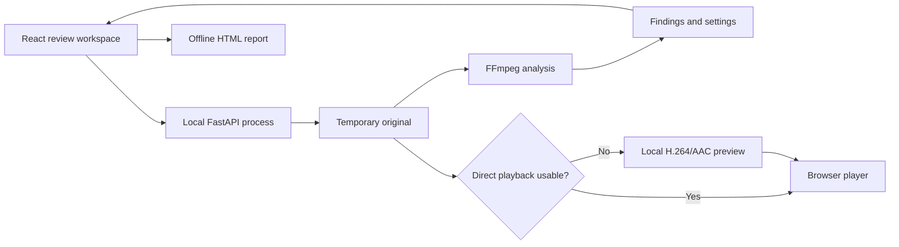

# FrameCheck — Technical Specification

Approved by the learner on 21 October 2026, including the support matrix, detection settings, timing tolerances, and operational safeguards below.

## How This Works, In Plain Language

The React workspace sends one video to a Python process running on this computer. Python saves a temporary copy, validates its actual contents and limits, and runs native FFmpeg against that original. The browser receives timestamped findings and holds review decisions in memory. If the browser cannot use the original for playback, Python produces a compatible preview with the same time reference. Preview failure leaves successful analysis and report export available.

The report is generated from the browser's complete analysis and current decisions as one self-contained HTML download. There is no database, external service, account, or persistent review history. This structure separates the expensive media work from a responsive review interface.

## Stack

The learner accepted **React + TypeScript + Vite**, **Python + FastAPI + native FFmpeg**, and **Chrome as the first supported browser**. Their priority is a reliable, polished end-to-end demo, especially design and presentation.

| Piece | Choice and reason | Documentation |
| --- | --- | --- |
| Workspace | React with TypeScript; explicit components and typed findings/review state | [React](https://react.dev/learn), [TypeScript](https://www.typescriptlang.org/docs/) |
| Frontend build | Vite; lightweight local development and a static production build | [Vite](https://vite.dev/guide/) |
| Local HTTP process | Python 3.12 and FastAPI, served by Uvicorn with one worker | [FastAPI](https://fastapi.tiangolo.com/), [Uvicorn](https://www.uvicorn.org/) |
| Media processing | Native FFmpeg and ffprobe; subprocess arguments, never a shell command built from input | [FFmpeg](https://ffmpeg.org/ffmpeg.html), [ffprobe](https://ffmpeg.org/ffprobe.html) |
| HTTP file serving | Starlette's range-capable FileResponse, supplied by FastAPI | [FileResponse](https://starlette.dev/responses/#fileresponse) |
| Tests | Python unittest for backend logic; Vitest for pure frontend behavior; Playwright against installed Chrome for end-to-end checks | [unittest](https://docs.python.org/3.12/library/unittest.html), [Vitest](https://vitest.dev/guide/), [Playwright](https://playwright.dev/docs/intro) |

Verified locally: Python 3.12.3, Node 24.19.0, FFmpeg 6.1.1-3ubuntu5, and Google Chrome 155.0.8059.84. Project framework packages are not installed yet. Resolve compatible stable packages during setup, pin the actual installed Python dependencies and commit the npm lockfile; do not describe an uninstalled version as tested. No media-processing wrapper, player library, component framework, database, task broker, or external font is needed.

The accepted tradeoff is a frontend build step. The production demo runs from one local Python process serving the built interface and API.

## Core Journey Through the System

Implements `prd.md > The Core Journey`.

1. **Upload video** streams the original file to the local API. **Try the demo** starts the same analysis pipeline with the bundled synthetic sample.
2. The backend checks size, actual container/codecs, stream structure, and normalized duration. One active job is allowed. Invalid input returns a specific error.
3. FFmpeg analyzes the original. Progress polling keeps the interface responsive and shows analysis separately from preview preparation.
4. After successful analysis, findings are available and export is enabled. For likely compatible media, the browser verifies actual video-frame readiness; unsupported or failed direct playback requests a preview. ProRes and materially offset timelines take the preview path directly.
5. A ready original or preview supplies the player's timeline. Selecting a finding pauses and seeks in that common time coordinate.
6. Review actions update the client-side decision map and overall counts. Selection and filter-aware navigation follow the approved PRD exactly.
7. Export uses every finding and current decision, the actual settings, and the playback outcome. It works even when preview preparation failed, with the failure clearly disclosed.



## Where It Runs and How Someone Tries It

Target the current Linux machine and Google Chrome first. A native FFmpeg installation must include the decoders in the matrix below and the `libx264`/AAC preview encoders. Check these at startup and show an actionable missing-tool error. Other operating systems/browsers are not claimed as tested.

Planned setup and production-demo commands, to be implemented and verified in `5-build`:

```bash
python3 -m venv .venv
.venv/bin/python -m pip install -r requirements.txt
npm --prefix frontend ci
npm --prefix frontend run build
.venv/bin/python scripts/generate_samples.py
.venv/bin/python -m uvicorn framecheck.server:app --host 127.0.0.1 --port 8765 --workers 1
```

Open `http://127.0.0.1:8765` in Chrome and choose **Try the demo**. The build must supply the lockfile before `npm ci` is usable. During development, run Vite with an `/api` proxy to the same backend; the production demo needs no separate frontend server. The hackathon deliverables remain the 1–3 minute recording and public GitHub repository. Deployment is optional and is not part of this specification.

## Media Support Matrix

Implements `prd.md > Video Intake and Limits` and `Analysis and Compatible Preview`.

This is the approved minimum support contract. A container extension alone is not proof of support. Verify the actual container and the selected streams with ffprobe, including video profile/pixel format. Initially support one ordinary video stream and zero or one audio stream; exclude attached pictures from video selection and clearly reject multiple playable video/audio tracks rather than silently reviewing an unspecified track. Ignore subtitle/data streams and disclose that they are not analyzed.

| Container | Supported video | Supported audio | Expected playback route |
| --- | --- | --- | --- |
| MP4 | H.264, 8-bit 4:2:0 | AAC-LC or none | Original when browser frame readiness succeeds; preview fallback |
| MOV | H.264, 8-bit 4:2:0 | AAC-LC or none | Original when browser frame readiness succeeds; preview fallback |
| MOV | ProRes 422 standard profile, `yuv422p10le` | PCM signed 16-bit little-endian or none | H.264 preview; AAC audio when present |
| MKV | H.264, 8-bit 4:2:0 | AAC-LC or none | Original when browser frame readiness succeeds; preview fallback |
| WebM | VP9 profile 0, 8-bit 4:2:0 | Opus or none | Original when browser frame readiness succeeds; preview fallback |

Do not claim HEVC, AV1, VP8, other audio codecs, HDR color fidelity, or every ProRes variant in the initial release. Unsupported combinations receive an English message naming the unsupported feature and supported alternatives. The learner accepted these bounded matrix choices when approving this specification.

All five audio-bearing combinations above passed the planning FFmpeg checks. The H.264 combinations, WebM, and generated preview passed playback/frame/seek smoke checks in the available in-app Chromium 155 browser; the ProRes original did not present a frame after seeking. Those build acceptance gates are now covered by the slice-1 application tests: standalone Chrome, no-audio variants and actual media routes. Details: [Media preflight](validation/README.md).

## Timestamp and Duration Contract

Implements `prd.md > Analysis and Compatible Preview`, `Timeline and Playback`, and `Standalone HTML Report`.

- Store times as finite floating-point elapsed seconds. Format display/report timestamps consistently as `HH:MM:SS.mmm`; calculate duration from unrounded end minus start. UI rounding must not change seeking or analysis data.
- Use a single source time origin for video and audio. Use matching FFmpeg `-copyts -start_at_zero` normalization for original analysis and preview generation. Never reset audio and video independently to their first frames, since that would remove an intentional delay between tracks.
- Probe stream/container metadata, then stream a packet timestamp scan for the selected streams. Compute each selected stream's maximum presentation end from packet PTS plus duration, relative to the shared origin. Use the maximum selected-stream extent as the review duration, with an explicit limit of 300 seconds. Do not treat `format.duration` alone as the canonical end for every container.
- Reject non-finite, missing, or unsupported timestamp layouts with a clear explanation if a trustworthy timeline cannot be established. AAC packets missing duration use the next audio packet's PTS only when the gap is positive and at most 0.1 seconds. Unresolved final durations are rejected; never invent a plausible duration.
- Retain the selected video and audio end times separately. An open frozen/black interval closes at video end, and an open silence interval at audio end. Do not extend findings into periods outside their source stream.
- Materially nonzero source starts use a normalized preview to avoid assuming browser-specific handling of offsets. Ordinary codec priming offsets still require fixture validation. Record the source origin and playback route in analysis metadata.
- Preserve variable frame timing using `-fps_mode vfr`. Do not apply fixed-rate conversion, `-shortest`, independent `setpts` resets, or trimming to the preview.
- Acceptance tolerance: known synthetic detection boundaries within **0.25 seconds**; original-to-preview black/audio landmarks within **0.10 seconds** on the test fixtures, with no accumulating drift. Test the start, middle, and end of longer media. Do not use repeat freeze detection alone to prove alignment, because compression can change its detection boundary.

The preflight observed at most 0.01201 seconds of original/preview difference on the checked offset, variable-rate, and delayed-audio cases. Browser-level landmark checks now pass for offset/VFR fixtures and the start/middle/end of the near-limit workload; see `validation/slice-4/README.md`. Preview output duration must be checked against the expected selected-stream extent; a mismatch beyond the alignment tolerance prevents marking the preview ready.

## Components

### Local API and Job Lifecycle

Implements `prd.md > Video Intake and Limits`, `Analysis and Compatible Preview`, and `States and Boundaries`.

`framecheck/server.py` exposes the API and built frontend. `framecheck/jobs.py` owns one in-memory current job and tracked asynchronous tasks. FFmpeg runs as a native subprocess; no broker or persistent queue is required. Keep a reference to each task, propagate failures into job state, and terminate its subprocess before cleanup. One Uvicorn worker is required so job state is not split between processes.

Use a streamed raw file request for the single-file upload, avoiding buffering 500 MB in memory or adding a multipart parser. Check `Content-Length` when present and count actual bytes while streaming. Stop and delete the incomplete temporary copy on overflow, disconnection, or validation failure. **500 MB means 500,000,000 bytes**; accept a normalized selected-stream duration of at most **300 seconds**.

Store a temporary original under a generated filename inside the app-owned job directory; the user-supplied filename is display metadata only. A new review explicitly replaces the current session; warn before discarding reviewed decisions. Do not replace a busy job silently. Normal shutdown and explicit replacement clean up the application's own original/preview files after terminating active work. A process crash can leave temporary files; document their location instead of promising crash-proof deletion or cross-session restoration.

On page load, configuration exposes the current job's ID and phase, if any. If the browser has no matching review state, explain that a previous job remains and offer **Reset current job**. Reset explicitly cancels it and waits for cleanup before enabling a new upload/demo. Do not silently replace a busy job or restore lost decisions. This makes reload recoverable without adding review persistence.

Bind to `127.0.0.1`, restrict accepted Host/Origin values to the local app/development origin, and do not enable permissive CORS. Only serve the current job's generated media paths through validated IDs; never accept arbitrary paths or remote video URLs. Launch FFmpeg with an argument list, `-nostdin`, bounded logs, and restricted input protocols. These checks keep the local file boundary explicit without adding accounts.

Resource safeguards: metadata/packet probing timeout **30 seconds**, analysis timeout **600 seconds**, preview timeout **600 seconds**, four codec worker threads, one FFmpeg process at a time, and a **1 GB preview output ceiling**. Check for roughly **2 GB free temporary space** before admitting a maximum-size job. Timeout, disk exhaustion, and preview output-limit errors must stop processing and follow the approved failure policy. These are operational limits, not processing-time promises.

### Media Inspection and Detection

Implements `prd.md > Analysis and Compatible Preview`.

`framecheck/media.py` handles ffprobe validation, timeline measurement, subprocess execution, and preview creation. `framecheck/detection.py` holds the fixed settings and parses FFmpeg detection events into intervals.

| Finding type | Fixed settings |
| --- | --- |
| Black frames | `blackdetect=d=0.5:pic_th=0.98:pix_th=0.10` |
| Frozen frames | `freezedetect=n=-60dB:d=1` |
| Silence | `silencedetect=n=-40dB:d=2`, combined audio-channel evaluation |

Use one full decode pass for video detection and the selected audio track. Skip the audio detector when no audio exists and return `has_audio: false`. Do not downsample the analysis source or analyze the preview. Persist the exact settings with the job and export them.

Parse streamed detector output into start/end pairs, handle open intervals at EOF, clamp to the appropriate normalized stream extent, and discard invalid/non-positive intervals. Keep overlapping findings of different types. Assign stable IDs and sort by start, then end, type, and ID for deterministic order. Do not relabel a finding as problematic based on detection alone.

Read stderr and stdout without blocking each other. FFmpeg `-progress` supplies phase progress where media time and duration are trustworthy; keep progress indeterminate for validation or unknown duration and never fabricate an overall percentage. Run analysis and preview with `-xerror` and level-tagged logs; treat error/fatal/panic messages as failure even with a zero process exit. The installed FFmpeg demonstrated this zero-exit failure on a damaged H.264 fixture. Only a complete pass without these errors exposes results as successful. Retain a bounded diagnostic tail for developer troubleshooting, while the UI receives concise errors.

### Playback Readiness and Preview

Implements `prd.md > Analysis and Compatible Preview`, `Timeline and Playback`, and `States and Boundaries`.

Use the browser's native video element. A MIME support hint or metadata event is not sufficient: require a valid video size and a decoded/presented frame. Give a direct-playback attempt a bounded readiness window; on failure, request a preview once. Known unsupported direct codecs and offset timelines go straight to preview preparation. A later media decoding error can also trigger the same single fallback.

The preview is MP4 containing H.264 (`libx264`, `veryfast`, CRF 23, `yuv420p`) and AAC when an audio track exists, with `+faststart`. Preserve source dimensions/aspect and variable timing; do not add a silent audio track to a video without audio. Do not overwrite the original. Verify output metadata, duration, and actual browser readiness before enabling playback-dependent controls.

Serve originals and previews with correct media types and byte-range support. The build must test `206 Partial Content` and seeking beyond the initially buffered portion through the actual server.

Keep analysis and playback/preview states separate. On preview failure, retain successful findings/settings, enable export, disclose the failure in UI/report, and disable play/pause, seeking, timeline navigation, and **Next unreviewed**. Finding details and explicit classification remain available; selecting details in this state never attempts to seek. Decisions remain **Unreviewed** unless the user explicitly changes them.

The client owns a separate playback outcome: `status` (`checking`, `preparing`, `ready`, or `unavailable`), `source` (`original`, `preview`, or null), and a readable `error` when unavailable. A successful server transcode does not imply browser readiness. If the generated preview also fails browser playback, set this client outcome to unavailable and apply the same failure policy. Export captures the current outcome, including pending checks or preparation, so it never claims playback was verified prematurely.

### Review Workspace and Navigation

Implements `prd.md > Screens and Layout`, `Timeline and Playback`, `Findings, Filters, and Review Decisions`, and `Accessibility and Responsive Review`.

`App.tsx` coordinates job phases and review state. `VideoWorkspace.tsx`, `Timeline.tsx`, and `FindingsPanel.tsx` render the main surfaces. Pure functions in `review.ts` implement filtering, counts, timestamp formatting, decision changes, and the next-finding calculation.

Keep the full findings array and a decision map keyed by stable finding ID. Type/status filters derive a visible subset; they never mutate the original array or report contents. The progress numerator counts all Intentional/Problematic decisions, regardless of filtering.

Selection stores a finding ID. Selecting with playable media pauses first, seeks to `max(0, start - 1)`, and highlights the same interval in both surfaces. When a decision removes selection from the filtered list, clear selection, retain the previous chronological navigation position, and pause without changing current time. **Next unreviewed** searches after that position in the stable full ordering, applies both filters plus Unreviewed status, and wraps once. With no previous position it starts at the beginning; with no match or no playable media it is disabled. A decision never invokes this function automatically.

The timeline has three labeled tracks, positioned from actual interval start/end over the duration. Keep hit targets separate from the visual interval so short findings retain their real duration. Provide labeled, keyboard-focusable controls; the findings panel remains a precise selection route when targets overlap in dense tracks. Native playback events update the playhead without resetting selection. Validate dense cases before adding any zoom or virtualization feature.

### HTML Report

Implements `prd.md > Standalone HTML Report` and `Language and Terminology`.

`report.ts` receives the complete job result, current decision map, and client playback outcome. Build an HTML document with native DOM APIs and `textContent` for all filenames, messages, settings, and finding values; export it as an HTML Blob. Do not interpolate untrusted strings into raw markup. Reuse the UI's labels and timestamp formatting. Include server preview errors and browser-only readiness/playback errors, even when encoding succeeded.

Embed all CSS and use system fonts. Include print styles that work on a light page, repeated table headers, wrapped filenames, and no clipped entries. Include all findings, progress, actual settings, audio availability, and playback/preview failure disclosure. The report contains no script, network dependency, or embedded source video. Revoke the temporary download URL after use.

## Data Model and HTTP Contract

Server memory holds a single `Job`: `job_id`, original filename, paths, byte count, detected container/codecs, selected stream indexes, shared origin, video/audio end times, duration, actual detector settings, findings, separate analysis/preview status/progress/error, and media URLs. Paths never appear in public responses. Findings contain stable `id`, `type`, `start`, `end`, and `duration`.

Use finding type values `black_frames`, `frozen_frames`, `silence`; decision values `unreviewed`, `intentional`, `problematic`. Frontend label constants supply the approved English labels. Keep each finding's decision solely in React memory; reloading or leaving the page starts a new review state. Temporary files may remain until replacement/server shutdown, but do not constitute saved review history.

| Endpoint | Request | Outcome |
| --- | --- | --- |
| `GET /api/config` | None | Limits, supported matrix, detector settings, tool readiness, current job ID/phase or null for explicit reset after reload |
| `POST /api/jobs?filename=...` | Raw file bytes | Validate/stream original; return `202` with job ID when accepted and start analysis |
| `POST /api/demo` | No file upload | Start the same pipeline with the bundled demo; return job ID |
| `GET /api/jobs/{id}` | None; poll about once per second while processing | Metadata, phase states, actual progress, successful findings/settings, errors, media availability |
| `POST /api/jobs/{id}/preview` | None | Idempotently request compatible preview after successful analysis; return current preview state |
| `GET /api/jobs/{id}/media/{original\|preview}` | Optional Range header | Current job's media, range-aware; no arbitrary path access |
| `DELETE /api/jobs/{id}` | Explicit replacement/reset | Stop work, then remove this job's temporary files and memory |

Use `413` for excessive bytes, `415` for unsupported container/codec, `422` for invalid video/timing/duration, `409` for busy or invalid phase transitions, and `404` for stale job IDs. Use an English error body with stable code and readable message. Mid-job failures stay in the separate job phase state so analysis success is not erased by preview failure. The browser ignores late responses for a replaced job.

## Look and Feel

Implements `prd.md > Look and Feel` and `Language and Terminology`.

Use plain CSS with variables, system sans-serif text, and `font-variant-numeric: tabular-nums`. Start with graphite background `#11151b`, subtly raised surfaces, near-white primary text, readable muted text, blue `#60a5fa` for selection/navigation, amber `#fbbf24` for Unreviewed, and red `#f87171` only for Problematic. Intentional uses a neutral labeled state. Verify contrast and focus in the rendered app.

Use a roughly `2fr 1fr` desktop grid, with the timeline below the player and a compact scrollable findings panel. Stack the panel below at smaller widths. Keep the filename, overall progress, and export action prominent without statistics cards. Selected state must be recognizable by border/label/focus as well as color. Use semantic buttons and labeled filter controls. No decorative gradients, external fonts, animation framework, or editing affordances.

## File Structure

```text
framecheck/
  __init__.py
  server.py                 # API, static build, media responses, local boundary
  jobs.py                   # One job, phase/task state, replacement and cleanup
  media.py                  # Probe, normalized timeline, subprocesses, preview
  detection.py              # Fixed settings and interval parsing
frontend/
  package.json
  package-lock.json
  index.html
  vite.config.ts            # React, local API proxy, production build
  vitest.config.ts          # Pure frontend tests
  playwright.config.ts      # Installed Chrome, isolated test server on port 8766
  e2e/
    intake.spec.ts          # Upload/playback, matrix, failure and layout checks
  tsconfig*.json
  src/
    main.tsx
    App.tsx                 # Processing/review phases and shared state
    VideoWorkspace.tsx      # Player, readiness, phase/failure presentation
    Timeline.tsx            # Three tracks, selection, playhead, keyboard access
    FindingsPanel.tsx       # Filters, entries, decisions, explicit continuation
    review.ts               # Types, labels, formatting, counts, navigation
    report.ts               # Safe standalone HTML generation and download
    styles.css
    review.test.ts          # Pure interaction and timestamp checks
scripts/
  generate_samples.py       # Deterministic demo, normal and validation fixtures
tests/
  test_detection.py         # Parser boundaries, EOF, missing audio, overlaps
  test_media.py             # Matrix, timestamps, limits, and subprocess failures
  test_api.py               # Upload bounds, stale IDs, safe paths, Range responses
samples/
  demo.mp4                  # Small generated sample committed for easy trying
  normal.mp4                # Small normal sample
  expected.json             # Known intervals and tolerances
requirements.txt            # Pinned runtime and necessary test dependencies
README.md                    # Setup, support matrix, limits, demo, cleanup
.gitignore                   # Keep personal context, credentials, builds and large test media out
devpost/
  learner-profile.md         # Ignored personal learning context
  project-brief.md
  scope.md                  # Approved
  prd.md                    # Approved
  spec.md                   # Approved technical plan
  checklist.md              # Build steps, verification and review progress
  validation/               # Existing preflight scripts, measurements and limitations
```

Large matrix/performance fixtures are generated into a temporary directory, not committed. The exact Playwright/Vitest config files can follow their minimal setup needs; do not add unused template components or infrastructure.

## Verification and Build Order

Implements the PRD's acceptance criteria; `5-build` will turn these into its working checklist.

1. **Media correctness first:** promote the preflight into meaningful tests using final thresholds. Validate the minimum matrix, no-audio variants, unsupported inputs, probeable files with decoding errors, start/EOF findings, VFR/shared offsets, delayed audio, and the 300-second/500,000,000-byte boundaries. Compare original/preview landmarks and browser seeking. This is the highest-risk part of the approved workflow.
2. **Working local path:** stream upload/demo → analyze → serve original/preview → show findings. Test actual Chrome readiness and range requests, including a seek beyond the initial buffer. Force preview failure after successful analysis and verify results/export survive; also test browser playback failure after a successful transcode and export while readiness is pending. Reload during a busy job, discover it, and explicitly reset before starting another.
3. **Complete review loop:** implement and test filters, manual decisions, restored Unreviewed, removed selection, forward/wrapping navigation, global counts, and stale-job handling. Verify keyboard focus and no automatic advancement.
4. **Accurate deliverable:** export all findings regardless of filters; verify all three decisions, failure disclosure, escaping of hostile filenames, offline loading, and browser print preview.
5. **Presentation pass:** check desktop/small-screen layouts, short and dense timeline intervals, empty/no-audio/error states, and the complete 1–3 minute demo. Measure the actual app on a near-limit file; include upload/probe/decode/preview overhead and note the hardware.

Run focused tests for changed behavior; do not substitute screenshot-only checks for media correctness. Do not claim all matrix combinations tested because one generated sample works. Record each acceptance result and limitation.

## Evidence, Simplifications, and Open Issues

- **Measured preflight:** a 482.28 MB, 299.89-second 1080p/30 synthetic H.264/AAC source analyzed in 12.257 seconds and previewed at full resolution in 39.710 seconds on this machine. Peak FFmpeg RSS was approximately 105 MiB for analysis and 350 MiB for preview. This is evidence for keeping the initial limits, not a promise for every resolution, codec, machine, or real-world recording. [Detailed measurements](validation/README.md).
- **Timestamp uncertainty identified by the learner:** preview correspondence and codec behavior were explicit priorities. The investigation tested shared offsets, variable frame rate, and delayed audio, and found the nonzero-start duration pitfall. Packet-derived extents and shared normalization address that observed issue; browser-level coverage is recorded in slices 1 and 4; representative real-footage exploration remains a final learner check.
- **Accepted architecture:** React/TypeScript/Vite, FastAPI/native FFmpeg, Chrome first. One process, one job, polling, memory-only review decisions, browser-generated HTML, and fixed thresholds keep the proof of concept small.
- **Decisions accepted with this specification:** the exact five-row codec matrix, one-video/at-most-one-audio-track policy, fixed thresholds, timing tolerances, and operational time/output limits. No universal codec or performance claim is made.
- **Build verification:** slice 1 now has pinned dependencies, real original analysis and preview handling, backend tests for the audio/no-audio matrix, and standalone Chrome integration checks. See `validation/slice-1/README.md` for exact evidence. Slices 2–4 add deliberate review, offline reports, dense rendered layouts and a near-five-minute/500 MB real-HTTP workload. See `validation/slice-4/README.md`. Real-footage/HDR behavior and full five-minute cases for every codec/resolution remain unverified.
- **Schedule:** the learner later said they are not in a rush and explicitly chose fast mode. Preserve verification and hands-on checkpoints before the 24 October deadline. Preview generation, its failure path, and timestamp validation are required work. If measurements invalidate a limit or a claimed supported combination, report it and agree a correction rather than silently dropping it.

This technical specification is approved. Continue with the working checklist and implementation in `5-build`.

- **Final application measurement:** 482,835,070-byte, 299.955273-second synthetic 1080p30 H.264/AAC video: upload 0.636 s; inspection about 0.205 s; analysis about 11.938 s; upload to successful analysis 12.778 s; compatible preview including output inspection 38.492 s. Chrome original/preview frame landmarks at 1, 149.8 and 298.8 seconds differ by at most 0.025065 s. Limits remain five minutes/500 MB, with no universal performance claim.
